# Rose Window — UML class diagram

<!-- Generated by scripts/generate-uml.mjs. Do not edit this file by hand. -->

This diagram is generated from **21 concrete production classes** in `src/`
using the TypeScript compiler API. `pnpm build` and `pnpm typecheck` regenerate it
after successful type checking. Run `pnpm uml` to regenerate it on its own.

Edit the TypeScript source to change this diagram. GitHub renders the Mermaid
block below as a UML class diagram.

```mermaid
classDiagram
    direction TB

    class BeamTracer {
        +number multiplierCap
        +BeamTracer(multiplierCap?)
        +trace(grid, entry) BeamPath
    }

    class Game {
        +GameConfig config
        +readonly [WindowPattern, WindowPattern] offeredPatterns
        +DealtObjectives objectives
        +readonly EntryPoint[] entrySequence
        -GamePhase phase
        -number round
        -GlassWindow | null window
        -DraftPool draftPool
        -Die | null hand
        -number placementsThisRound
        -number refreshesRemaining
        -number[] roundScores
        -number totalScore
        -ScoreReport | null report
        -DiceBag bag
        -Set~GameListener~ listeners
        -PlacementValidator validator
        -BeamTracer beamTracer
        -ScoreCalculator scoreCalculator
        +GamePhase phase
        +number round
        +GlassWindow | null window
        +DraftPool draftPool
        +Die | null hand
        +number refreshesRemaining
        +number placementsRemaining
        +EntryPoint currentEntry
        +readonly number[] roundScores
        +number totalScore
        +ScoreReport | null report
        +Game(config)
        +subscribe(listener) Function
        -emit(event) void
        -requirePhase(phase) void
        +choosePattern(id) void
        +selectDie(die) void
        +cancelSelection() void
        +refreshDraft() void
        +placeDie(position) void
        +forfeitRound() void
        +legalPlacementsFor(die) readonly Position[]
        +hasLegalMove() boolean
        -beginRoundDraft() void
        -endRound() void
        -illuminateAndAdvance() void
    }

    class ScoreCalculator {
        +TierThresholds tiers
        +ScoreCalculator(tiers?)
        +calculate(input) ScoreReport
    }

    class BeamPath {
        +readonly BeamSegment[] segments
        +number totalScore
        +BeamTermination termination
        +number length
        +number bendCount
        +number peakMultiplier
        +BeamPath(segments, termination)
        +toData() LegacyBeamPathData
    }

    class BeamSegment {
        +Position position
        +Direction direction
        +Die | null die
        +number multiplier
        +number points
        +boolean struck
        +BeamSegment(position, direction, die, multiplier)
        +toData() LegacyBeamSegmentData
    }

    class OpenConstraint {
        +'open' kind
        +OpenConstraint()
        +accepts(die) boolean
        +describe() string
    }

    class ColorConstraint {
        +'color' kind
        +DieColor color
        +ColorConstraint(color)
        +accepts(die) boolean
        +describe() string
    }

    class ValueConstraint {
        +'value' kind
        +number value
        +ValueConstraint(value)
        +accepts(die) boolean
        +describe() string
    }

    class DiceBag {
        -Die[] dice
        +number remainingCount
        +DiceBag(config, rng)
        +contents() Die[]
        +draw(n) Die[]
        +return(dice) void
    }

    class Die {
        +1 MIN_VALUE$
        +6 MAX_VALUE$
        +DieColor color
        +number value
        +Die(color, value)
        +equals(a, b) boolean$
        +from(data) Die$
        +toString() string
    }

    class Direction {
        +Direction NORTH$
        +Direction EAST$
        +Direction SOUTH$
        +Direction WEST$
        +readonly Direction[] ALL$
        +DirectionName name
        +number rowDelta
        +number colDelta
        +Position delta
        -Direction(name, rowDelta, colDelta)
        +clockwise() Direction
        +counterClockwise() Direction
        +step(from) Position
        +fromName(name) Direction$
        +toString() string
    }

    class DraftPool {
        -Die[] dice
        +readonly Die[] dice
        +number size
        +DraftPool(dice)
        +contains(dice, die) boolean$
        +contains(die) boolean
        +take(die) Die
        +putBack(dice) void
        +clear() void
    }

    class EntryPoint {
        +Position position
        +Direction direction
        +EntryPoint(position, direction)
        +allFor(gridSize) readonly EntryPoint[]$
        +isInwardFor(gridSize) boolean
        +equals(other) boolean
        +fromData(data) EntryPoint$
        +toData() EntryPointData
    }

    class GameConfig {
        +number seed
        +number rounds
        +number gridSize
        +number draftSize
        +number placementsPerRound
        +number copiesPerDie
        +number multiplierCap
        +TierThresholds tiers
        +GameConfig(seed, overrides?)
    }

    class GameError {
        +GameViolation violation
        +GameError(violation)
        +describe(violation) string$
    }

    class PlacementError {
        +PlacementViolation violation
        +PlacementError(violation)
    }

    class GlassWindow {
        +WindowPattern pattern
        +number gridSize
        -WindowCell[][] cells
        +readonly Array~readonly CellConstraint[]~ constraints
        +DieGrid dice
        +number placedCount
        +boolean isEmpty
        -GlassWindow(pattern)
        +fromPattern(pattern) GlassWindow$
        +isInside(position) boolean
        +dieAt(position) Die | null
        +cellAt(position) WindowCell
        +place(die, position) void
        +remove(position) void
        +occupiedPositions() Position[]
        -assertInside(position) void
    }

    class PlacementValidator {
        -readonly PlacementLaw[] laws
        +findViolation(check) PlacementViolation | null
        +assertValid(check) void
        +isInsideGrid(position, size) boolean$
        +isOnBorderRing(position, size) boolean$
        +countPlaced(grid) number$
        -dieAt(grid, row, col) DieData | null$
        -cellOccupied(c) PlacementViolation | null
        -dieNotInPool(c) PlacementViolation | null
        -constraintMismatch(c) PlacementViolation | null
        -adjacency(c) PlacementViolation | null
        -illegalFirstPlacement(c) PlacementViolation | null
        -disconnected(c) PlacementViolation | null
    }

    class SeededRandom {
        +number seed
        -number state
        +SeededRandom(seed)
        +next() number
        +shuffled(items) T[]
        +sample(items, count) T[]
        +shuffled(items, rng) T[]$
        +sample(items, count, rng) T[]$
    }

    class WindowCell {
        +CellConstraint constraint
        +Die | null die
        +boolean isEmpty
        +WindowCell(constraint, die?)
        +satisfiedBy(die) boolean
        +withDie(die) WindowCell
        +cleared() WindowCell
    }

    class WindowPattern {
        +string id
        +string name
        +string description
        +readonly Array~readonly CellConstraint[]~ constraints
        +number gridSize
        +number demandCount
        +WindowPattern(id, name, description, constraints)
        +fromRows(id, name, description, rows, gridSize?) WindowPattern$
        +parseConstraints(rows) CellConstraint[][]$
        +constraintAt(position) CellConstraint
        +offer(rng) [WindowPattern, WindowPattern]$
        +byId(id) WindowPattern$
    }

    BeamPath --> BeamSegment : has
    BeamPath ..> Die : uses
    BeamSegment --> Die : has
    BeamSegment --> Direction : has
    BeamTracer ..> Die : uses
    ColorConstraint ..> GameError : uses
    DiceBag --> Die : has
    DiceBag ..> GameConfig : uses
    DiceBag ..> GameError : uses
    DiceBag ..> SeededRandom : uses
    Die ..> GameError : uses
    Direction ..> GameError : uses
    DraftPool --> Die : has
    DraftPool ..> PlacementError : uses
    EntryPoint --> Direction : has
    Game --> BeamTracer : has
    Game --> DiceBag : has
    Game --> Die : has
    Game --> DraftPool : has
    Game --> GameConfig : has
    Game --> GlassWindow : has
    Game --> PlacementValidator : has
    Game --> ScoreCalculator : has
    Game --> WindowPattern : has
    Game ..> GameError : uses
    Game ..> PlacementError : uses
    Game ..> SeededRandom : uses
    GameConfig ..> GameError : uses
    GameError <|-- PlacementError
    GlassWindow --> WindowCell : has
    GlassWindow --> WindowPattern : has
    GlassWindow ..> Die : uses
    GlassWindow ..> GameError : uses
    PlacementValidator --> Die : has
    PlacementValidator ..> DraftPool : uses
    PlacementValidator ..> GameError : uses
    PlacementValidator ..> PlacementError : uses
    ScoreCalculator ..> Die : uses
    SeededRandom ..> GameError : uses
    ValueConstraint ..> Die : uses
    ValueConstraint ..> GameError : uses
    WindowCell --> Die : has
    WindowCell ..> PlacementError : uses
    WindowPattern ..> GameError : uses
    WindowPattern ..> SeededRandom : uses
```

How to read it:

- Each box lists a class's fields and operations. `+` means public, `-` private,
  and `#` protected. Static members are underlined. Accessors appear as fields;
  callable fields appear as operations. Parameters show names; types and
  nullable results come from the compiler. Object shapes are shortened to
  `object`, callback return types to `Function`, and generic brackets to `~`.
- Solid arrows (`has`) represent field references, including references inside
  arrays, unions, and project data records. They do not assert lifecycle ownership.
- Dashed arrows (`uses`) represent other references in a class's code or types.
  Hollow triangles point to parent classes. Relationships to built-in types,
  interfaces, aliases, and classes outside this production inventory are omitted.
- Interfaces, type aliases, React function components, abstract/ambient classes,
  and test helpers do not count toward this concrete class inventory.
- Class and relationship order is deterministic; unchanged source does not
  rewrite the file. Source links below identify classes with the same name.

Source inventory:

- [BeamTracer](../src/engine/beamTracer.ts#L54) — `src/engine/beamTracer.ts`
- [Game](../src/engine/game.ts#L33) — `src/engine/game.ts`
- [ScoreCalculator](../src/engine/scoreCalculator.ts#L111) — `src/engine/scoreCalculator.ts`
- [BeamPath](../src/model/BeamPath.ts#L33) — `src/model/BeamPath.ts`
- [BeamSegment](../src/model/BeamSegment.ts#L32) — `src/model/BeamSegment.ts`
- [OpenConstraint](../src/model/CellConstraint.ts#L34) — `src/model/CellConstraint.ts`
- [ColorConstraint](../src/model/CellConstraint.ts#L66) — `src/model/CellConstraint.ts`
- [ValueConstraint](../src/model/CellConstraint.ts#L111) — `src/model/CellConstraint.ts`
- [DiceBag](../src/model/DiceBag.ts#L16) — `src/model/DiceBag.ts`
- [Die](../src/model/Die.ts#L31) — `src/model/Die.ts`
- [Direction](../src/model/Direction.ts#L18) — `src/model/Direction.ts`
- [DraftPool](../src/model/DraftPool.ts#L15) — `src/model/DraftPool.ts`
- [EntryPoint](../src/model/EntryPoint.ts#L20) — `src/model/EntryPoint.ts`
- [GameConfig](../src/model/GameConfig.ts#L42) — `src/model/GameConfig.ts`
- [GameError](../src/model/GameError.ts#L85) — `src/model/GameError.ts`
- [PlacementError](../src/model/GameError.ts#L148) — `src/model/GameError.ts`
- [GlassWindow](../src/model/GlassWindow.ts#L27) — `src/model/GlassWindow.ts`
- [PlacementValidator](../src/model/PlacementValidator.ts#L48) — `src/model/PlacementValidator.ts`
- [SeededRandom](../src/model/SeededRandom.ts#L29) — `src/model/SeededRandom.ts`
- [WindowCell](../src/model/WindowCell.ts#L13) — `src/model/WindowCell.ts`
- [WindowPattern](../src/model/WindowPattern.ts#L48) — `src/model/WindowPattern.ts`

See the [class responsibilities](class-structure.md) for the assignment context.
