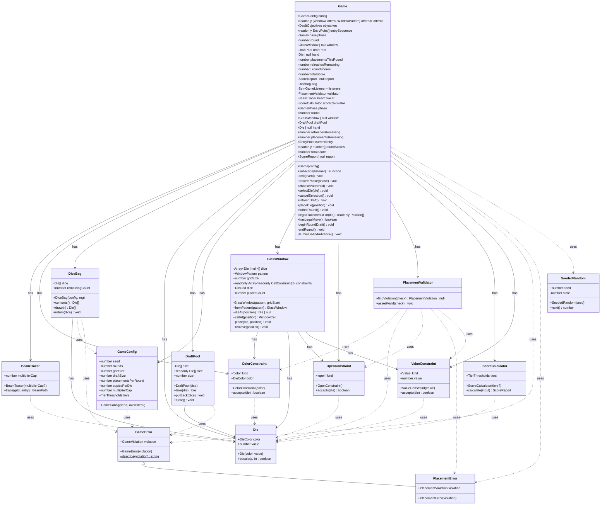

# Rose Window — UML class diagram

<!-- Generated by scripts/generate-uml.mjs. Do not edit this file by hand. -->

This diagram is generated from **15 concrete production classes** in `src/`
using the TypeScript compiler API. `pnpm build` and `pnpm typecheck` regenerate it
after successful type checking. Run `pnpm uml` to regenerate it on its own.

Edit the TypeScript source to change this diagram. GitHub renders the Mermaid
block below as a UML class diagram.

How to read it:

- Each box lists a class's fields and operations. `+` means public, `-` private,
  and `#` protected. Static members are underlined. Accessors appear as fields;
  callable fields appear as operations. Parameters show names; types and
  nullable results come from the compiler. Object shapes are shortened to
  `object`, callback return types to `Function`, and generic brackets to `~`.
- Solid arrows (`has`) represent field references, including references inside
  arrays, unions, and project data records. They do not assert lifecycle ownership.
- Dashed arrows (`uses`) represent other references in a class's code or types.
  Hollow triangles point to parent classes. Relationships to built-in types,
  interfaces, aliases, and classes outside this production inventory are omitted.
- Interfaces, type aliases, React function components, abstract/ambient classes,
  and test helpers do not count toward this concrete class inventory.
- Class and relationship order is deterministic; unchanged source does not
  rewrite the file. Source links below identify classes with the same name.

Source inventory:

- [BeamTracer](../src/engine/beamTracer.ts#L54) — `src/engine/beamTracer.ts`
- [DiceBag](../src/engine/diceBag.ts#L13) — `src/engine/diceBag.ts`
- [DraftPool](../src/engine/draftPool.ts#L10) — `src/engine/draftPool.ts`
- [Game](../src/engine/game.ts#L33) — `src/engine/game.ts`
- [GlassWindow](../src/engine/glassWindow.ts#L16) — `src/engine/glassWindow.ts`
- [PlacementValidator](../src/engine/placementValidator.ts#L66) — `src/engine/placementValidator.ts`
- [SeededRandom](../src/engine/rng.ts#L10) — `src/engine/rng.ts`
- [ScoreCalculator](../src/engine/scoreCalculator.ts#L111) — `src/engine/scoreCalculator.ts`
- [Die](../src/engine/types.ts#L57) — `src/engine/types.ts`
- [OpenConstraint](../src/engine/types.ts#L96) — `src/engine/types.ts`
- [ColorConstraint](../src/engine/types.ts#L108) — `src/engine/types.ts`
- [ValueConstraint](../src/engine/types.ts#L122) — `src/engine/types.ts`
- [GameConfig](../src/model/GameConfig.ts#L39) — `src/model/GameConfig.ts`
- [GameError](../src/model/GameError.ts#L85) — `src/model/GameError.ts`
- [PlacementError](../src/model/GameError.ts#L148) — `src/model/GameError.ts`

See the [class responsibilities](class-structure.md) for the assignment context.
